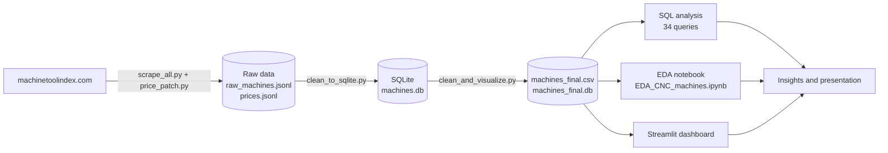

# CNC Machine Tools: Use Case and Workflow

## 1. Use Case

### Business question
**How can a buyer choose the most suitable CNC machine for a given budget and size requirement?**

### Who needs this
- A workshop owner or purchasing engineer who must shortlist machines before asking suppliers for quotes.
- A student or analyst who wants to understand how machine price relates to size, weight and power.

### The problem today
Machine information is spread over thousands of separate pages. Specs are written as text with mixed units (`6,420 lb (2,915 kg)`), the same spec has different names on different pages, and most prices are only estimates. A buyer cannot compare machines side by side without cleaning all of this first.

### Our solution
We collected the machine pages from machinetoolindex.com, cleaned them into one comparable table, stored them in SQLite, analyzed them with SQL and Python, and built a dashboard where the buyer enters a budget and requirements and gets a shortlist.

### What the user can do in the dashboard
1. Filter by category, manufacturer, budget and minimum travel (X, Y, Z).
2. See how many machines match and a ranked shortlist with the key specs.
3. See the price distribution and median price per category.
4. See how price changes with machine size and weight.
5. See which prices are estimated and which are listed, so the result is not over-trusted.

### Data in numbers
| Item | Value |
|---|---|
| Machines collected | 3,955 |
| Categories collected | 6 of the 19 on the website |
| Manufacturers | 219 |
| Machines with a price | 1,564 (39.5%) |
| Prices that are estimates | 1,480 of 1,564 (only 84 are listed prices) |

### Main insights
- Price follows size: X travel and machine weight both have a strong rank correlation with price (about 0.74).
- Category matters most: lathes have the lowest median price ($200,000), boring machines the highest ($950,000).
- Spindle speed alone says little about price (correlation about 0.33).
- The median price ($375,000) is lower than the mean ($646,823), because a few very expensive machines pull the mean up.

### Limits (stated openly)
- Only 6 of 19 website categories were scraped, so conclusions apply to these categories only.
- 60% of machines have no price, and almost all prices are website estimates, not quotes.
- Missing specs were left empty and never guessed.

---

## 2. Workflow

### Steps in detail
| # | Step | What happens | Tool | Output |
|---|---|---|---|---|
| 1 | Scraping | Read the category pages, then every machine page. Save after each machine, retry failures, log failed URLs. | Python, requests, BeautifulSoup | `02_raw_data/raw_machines.jsonl`, `prices.jsonl` |
| 2 | Cleaning | Merge duplicate columns, parse text specs into numbers with one unit (mm, kg, kW, rpm), split price into low / mid / high, fix encoding. | Python, pandas | `04_database/machines.db` |
| 3 | Quality pass | Merge manufacturer spellings, fix impossible values, flag outliers, add `price_type` and a completeness score. | Python, pandas | `07_data_outputs/machines_final.csv`, `03_cleaning/cleaning_report.csv` |
| 4 | SQL analysis | 34 read-only queries: coverage, medians, price bands, machine finder. | SQLite | `05_sql/results_34.xlsx` |
| 5 | EDA | Distributions, category comparison, price vs size, data limits. | Jupyter, pandas, matplotlib | `06_notebook/EDA_CNC_machines.ipynb`, `08_visuals/` |
| 6 | Dashboard | Budget-based machine finder and charts. | Streamlit | `09_dashboard/` |
| 7 | Delivery | Presentation, LinkedIn post, this document. | PowerPoint | `10_presentation/` |

### Design decisions
- **Raw data is never edited.** Every cleaning step starts from `raw_machines.jsonl`, so the whole pipeline can be re-run.
- **Flag, do not delete.** Extreme machines are real (large gantry and boring machines), so they get an `outlier_*` flag.
- **Never guess missing values.** A made-up spec or price would be wrong data.
- **Estimated prices are labeled.** Every price chart says whether the price is an estimate.
- **Every script finds its files by itself,** so the project runs from any folder as long as the folder structure is kept.

### Team split (5 members)
The scraping can be split by category (`python scrape_all.py 0 4`, `python scrape_all.py 4 8`, ...), then merged. Cleaning, SQL, EDA, dashboard and presentation can then run in parallel on the same `machines_final.csv`.
