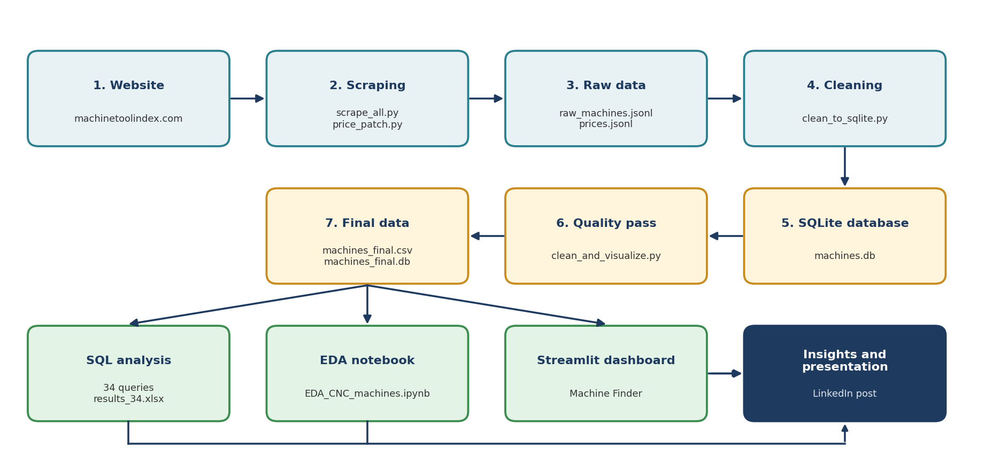

# CNC Machine Finder

A data project that helps a buyer choose a CNC machine for a given **budget** and **machine size**.
We collected 3,955 machine listings from a public website, cleaned them into one comparable table,
analysed them with SQL and Python, and built an interactive dashboard that turns a budget into a shortlist.



## Contents

1. [The project in plain words](#1-the-project-in-plain-words)
2. [The problem we wanted to solve](#2-the-problem-we-wanted-to-solve)
3. [The data](#3-the-data)
4. [How the project works, step by step](#4-how-the-project-works-step-by-step)
5. [What we found](#5-what-we-found)
6. [Using the dashboard](#6-using-the-dashboard)
7. [How to run it](#7-how-to-run-it)
8. [Repository structure](#8-repository-structure)
9. [Data dictionary](#9-data-dictionary)
10. [Limitations and honest notes](#10-limitations-and-honest-notes)
11. [Glossary](#11-glossary)
12. [Tools and responsible scraping](#12-tools-and-responsible-scraping)

---

## 1. The project in plain words

Imagine you run a small workshop and want to buy a CNC machine (a computer-controlled machine that cuts metal).
You have a budget of, say, $300,000 and you need a machine that is big enough for your parts.

The information you need exists on the internet, but it is spread across thousands of separate web pages.
Each page lists the specifications in its own way, with mixed units, and most prices are only estimates.
Comparing machines by hand would take days.

So we did the work once, for everyone:

1. **Collected** the information from the website with a small program (web scraping).
2. **Cleaned** it so that every machine is described in the same way and the same units.
3. **Analysed** it with SQL and Python to understand how price relates to size, weight and power.
4. **Built a dashboard** where you type your budget and minimum size and get a ranked list of machines.

## 2. The problem we wanted to solve

> **How can a buyer choose the most suitable CNC machine for a given budget and size?**

Who it is for:

- Workshop owners and purchasing engineers who shortlist machines before asking suppliers for quotes.
- Students and analysts who want to see how machine price relates to size, weight and power.

Why it is hard without this project:

| Difficulty | Example |
|---|---|
| Scattered | Every machine has its own page. There is no single table. |
| Mixed units | `15 in (381 mm)`, `15 hp (11.2 kW)`, `100 lb (45.4 kg)` |
| Uncertain prices | 95% of the prices we found are the website's own estimates, not quotes. |
| Inconsistent names | The same spec appears as `X Axis Travel` and `X-Axis Travel`. Manufacturers are spelled in several ways. |

## 3. The data

- **Source:** [machinetoolindex.com](https://www.machinetoolindex.com), a public website that lists CNC machines.
- **Size:** 3,955 machines, 219 manufacturers.
- **Categories collected (6 of the website's 19):** CNC lathes, 5-axis machining centers, grinding machines,
  laser cutting machines, boring machines and gear cutting machines.
- **Prices:** 1,564 machines (39.5%) have a price. Of those, 1,480 are *estimates* made by the website and
  84 are *listed* prices published by the manufacturer. The other 2,391 machines have no price.
- **Specifications we keep as numbers:** X, Y and Z travel (mm), machine weight (kg), spindle power (kW),
  maximum spindle speed (rpm), maximum table load (kg) and tool capacity.

An important point about prices: an **estimate** is the website's own planning number, for example
`Est. $200,000 - $275,000`. It is not a quote from the manufacturer. We always keep the two kinds apart
(`price_type` = `estimate` or `listed`) and say so in every chart.

## 4. How the project works, step by step

```
website  ->  scraping  ->  raw data  ->  cleaning  ->  SQLite database  ->  quality pass
                                                                              |
                                              machines_final.csv  <-----------+
                                                  |        |         |
                                             34 SQL     EDA        Streamlit
                                             queries  notebook     dashboard
```

### Step 1. Scraping (`01_scraping/`)

**What:** A Python program visits the category pages of the website, finds every machine page, and reads the
specification table on each one.
**Why:** The data is only available as web pages, so we need a program to read it.
**How it stays safe:** It saves after every machine, retries failed pages three times, logs failed URLs, and
waits between requests so it does not overload the website.
**Files:** `scrape_all.py` (specifications) and `price_patch.py` (prices, fetched separately).
**Output:** `02_raw_data/raw_machines.jsonl` and `prices.jsonl`.
The raw data is never edited. Every later step starts from it, so the whole project can be rebuilt.

### Step 2. Cleaning (`03_cleaning/clean_to_sqlite.py`)

**What:** Turns messy text into clean numbers.
The raw file has **5,213 columns**, because every machine type lists different specifications.
The cleaning script:

- merges duplicate columns (`X Axis Travel` and `X-Axis Travel`),
- converts text such as `15 hp (11.2 kW)` to the number `11.2` in one unit (mm, kg, kW, rpm),
- splits price text such as `Est. $200,000 - $275,000` into a low, high and midpoint value, plus a price type,
- fixes broken characters caused by wrong text encoding,
- merges manufacturer spellings (226 variants become 219 names).

**Output:** `04_database/machines.db`, a SQLite database.

### Step 3. Quality pass (`03_cleaning/clean_and_visualize.py`)

**What:** Checks the cleaned data and records every issue in `cleaning_report.csv`.
The rule we followed: **flag, do not delete, and never guess.**

- Extreme values (for example 26 very high prices) are real large machines, so they get an `outlier_*` flag.
- A missing specification stays empty. We never fill it with an invented value.
- Impossible values (for example a machine weight under 100 kg caused by a unit error at the source) are set to missing.

**Output:** `07_data_outputs/machines_final.csv` (the main file) and ten charts in `08_visuals/`.

### Step 4. SQL analysis (`05_sql/`)

**What:** 34 read-only queries on the SQLite database answer questions such as:
how many machines per category, what is the median price per category, which manufacturers have the most
machines, how complete is each specification, and which machines fit a given budget (the "machine finder").
**Output:** `results_34.xlsx` and `results_34.txt`. A MySQL version of the queries is in `05_sql/mysql/`.

### Step 5. Exploration notebook (`06_notebook/EDA_CNC_machines.ipynb`)

**What:** A Jupyter notebook that explores the data with charts: distributions, price by category,
price against size, correlations, and the limits of the data.

### Step 6. Dashboard (`09_dashboard/app.py`)

**What:** A Streamlit web app on top of `machines_final.csv`. See [Using the dashboard](#6-using-the-dashboard).

## 5. What we found

| Finding | Evidence |
|---|---|
| **Machine type sets the price level.** | Median price: lathes $200K, grinding $425K, laser $550K, 5-axis $600K, gear cutting $788K, boring $950K. |
| **Bigger and heavier machines cost more.** | Rank correlation with price: X travel 0.75, machine weight 0.74, spindle power 0.57. |
| **Spindle speed alone says little about price.** | Rank correlation 0.34. |
| **The median is lower than the mean.** | Median $375K, mean $647K. A few very expensive machines pull the mean up. |
| **Almost all prices are estimates.** | 95% of the 1,564 prices are website estimates. All 84 listed prices come from one manufacturer (Haas). |

## 6. Using the dashboard

The dashboard has four tabs:

- **Machine Finder:** enter your requirements and get a ranked shortlist with a link to each machine's page.
- **Market overview:** median price by category and by manufacturer, and how prices are distributed.
- **Price vs size:** one chart per category showing how price changes with size, weight, power or speed.
- **Data quality:** how complete each specification is, and how many prices are estimates.

The left sidebar holds the filters: category, budget (in thousands of dollars), whether to show machines
without a price, price type, minimum size (X, Y, Z travel and spindle power) and manufacturer.

**Example 1 - a small workshop looking for a lathe.**
Category = `CNC Lathes`, budget $100K to $300K. Result: 413 machines with a median price of $175K.
Rank by "Most complete specs" or "Lowest price" to narrow the list.

**Example 2 - a larger 5-axis machine.**
Category = `5 Axis Machining Centers`, budget up to $600K, then open "Minimum machine size" and set
Min X travel = 1000. Result: 41 machines.

**Example 3 - only trustworthy prices.**
Price type = `listed` only. Result: 84 machines, all from Haas. This shows that only one manufacturer
publishes its prices and the rest are estimates.

## 7. How to run it

You need Python 3.10 or newer.

```bash
git clone <your-repository-url>
cd machine_tools_project
pip install -r requirements.txt
streamlit run 09_dashboard/app.py
```

The dashboard opens in the browser at `http://localhost:8501`. On Windows, use backslashes in paths
(`09_dashboard\app.py`). If `streamlit` is not recognized, use `python -m streamlit run 09_dashboard/app.py`.

To rebuild the data without scraping again (every script finds its files by itself, from any folder):

```bash
python 03_cleaning/clean_to_sqlite.py        # raw_machines.jsonl -> 04_database/machines.db
python 03_cleaning/clean_and_visualize.py    # machines.db -> machines_final.csv + 08_visuals
python 05_sql/run_sql_scenarios_xlsx.py      # 34 SQL queries -> 05_sql/results_34.xlsx
```

The scraper (`01_scraping/scrape_all.py`) is only needed to collect the data again from the website.
The notebook is `06_notebook/EDA_CNC_machines.ipynb` and reads `07_data_outputs/machines_final.csv`.

## 8. Repository structure

| Folder | What is inside |
|---|---|
| `01_scraping` | `scrape_all.py`, `price_patch.py` - data collection |
| `02_raw_data` | `raw_machines.jsonl`, `prices.jsonl` - raw data, never edited |
| `03_cleaning` | cleaning scripts and `cleaning_report.csv` (every issue found and what we did) |
| `04_database` | `machines.db`, `machines_final.db` - SQLite databases |
| `05_sql` | 34 SQL queries, a runner script, results; `mysql/` has a MySQL version |
| `06_notebook` | `EDA_CNC_machines.ipynb` |
| `07_data_outputs` | `machines_final.csv` (use this one), `machines_core.csv`, `machine_specs.csv` |
| `08_visuals` | ten charts (PNG) |
| `09_dashboard` | the Streamlit dashboard |
| `10_presentation` | presentation, use case and workflow documents, workflow diagram, LinkedIn post |
| `tests` | unit tests for the parsers and validation scripts |

## 9. Data dictionary

Main file: `07_data_outputs/machines_final.csv` (one row per machine, 29 columns).

| Column | Meaning |
|---|---|
| `Machine Name`, `Manufacturer`, `Category`, `URL` | Identity of the machine and its source page |
| `price_low_usd`, `price_high_usd`, `price_mid_usd` | Price range in US dollars and its midpoint (empty if no price) |
| `price_type` | `estimate` (website estimate) or `listed` (published by the manufacturer) |
| `has_price` | 1 if the machine has a price, otherwise 0 |
| `x_travel_mm`, `y_travel_mm`, `z_travel_mm` | How far the machine can move along each axis, in millimetres (a measure of size) |
| `machine_weight_kg` | Machine weight in kilograms |
| `spindle_power_kw` | Spindle motor power in kilowatts |
| `max_spindle_rpm` | Maximum spindle speed in revolutions per minute |
| `max_table_load_kg` | Maximum load the table can carry, in kilograms |
| `tool_capacity` | Number of tools the machine can hold |
| `spindle_taper`, `taper_family` | Tool holder type as written on the site, and its grouped family |
| `spec_completeness` | How many of the 8 key specifications are known for the machine |
| `outlier_*` | 1 if the value is extreme compared with other machines (flagged, not removed) |
| `is_name_duplicate`, `price_spread_ratio` | Quality flags: repeated name, and high price divided by low price |

## 10. Limitations and honest notes

- Only **6 of the website's 19 categories** were collected, so the results describe these categories only.
- **60% of machines have no price**, and almost every price that exists is an estimate.
  The dashboard is for comparing and shortlisting. A real quotation is still needed before buying.
- Specifications that the website does not publish stay empty. When a minimum size is set in the dashboard,
  machines with an unknown value are left out.
- Correlation is not causation. Size and price move together, but this project does not show that size causes the price.
- The prices are as published on the website at the time of collection and may change.

## 11. Glossary

| Term | Meaning |
|---|---|
| Web scraping | Using a program to read data from web pages automatically |
| JSONL | A text file where each line is one record (here, one machine) |
| CSV | A simple table saved as text, which Excel and pandas can open |
| SQLite / SQL | A small database stored in one file, and the language used to ask it questions |
| Median | The middle value when prices are sorted. It is not pulled up by a few very expensive machines. |
| Mean | The average. A few very high prices can raise it. |
| Rank correlation (Spearman) | A number from -1 to 1 showing whether two measures rise together. 1 means they rise in step. |
| Outlier | A value much larger or smaller than most others |
| Travel (X, Y, Z) | How far the machine moves along each axis, a measure of the size of part it can work on |
| Spindle | The rotating part that holds the cutting tool or the workpiece |

## 12. Tools and responsible scraping

**Tools:** Python, requests, BeautifulSoup, pandas, NumPy, SQLite, Matplotlib, Seaborn, Plotly,
Jupyter and Streamlit.

**Scraping:** The website's `robots.txt` allows crawling outside `/api/` and asks for a 2-second delay between
requests. The scraper waits between requests and does not use the `/api/` paths. The data belongs to the
website. This repository is an educational project, so check the website's terms of use before reusing or
redistributing the data.

<!-- Team: add the names of the team members here -->
